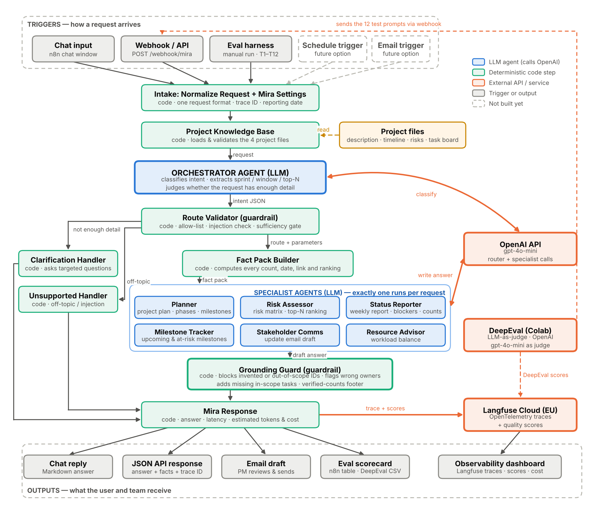
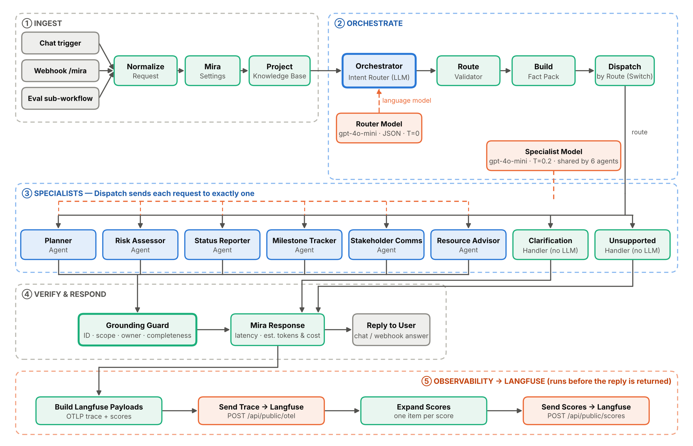

# Mira - AI-Powered Project Intelligence Assistant

**Interview Kickstart capstone · Applied Agentic AI for PMs / TPMs** · Author: Sivaprasad

Mira helps project managers at Nexora get answers about the **ABCDE Ltd. AI Adoption Project** in seconds: project plans, risk assessments, weekly status reports, blocked and at-risk tasks, milestone alerts and stakeholder emails. Every answer is grounded in the project's own files.

It was first built in Langflow and **re-architected in n8n** as a *guarded router* multi-agent workflow, with **Langfuse** for observability and **DeepEval** (LLM-as-a-judge) for evaluation.

| Result | Value |
|---|---|
| Baseline tests (T1–T12) passed | **12 / 12** (n8n test harness, final run 7 Oct 2026) |
| Correct routing | 12 / 12 |
| Hallucinations (Grounding Guard fallbacks) | **0** |
| DeepEval faithfulness (8 fact-based answers) | **0.962** (8 / 8 ≥ 0.7) |
| DeepEval requirement compliance (G-Eval) | **0.960** (12 / 12 ≥ 0.7) |
| DeepEval answer relevancy (7 scorable) | 0.819 (5 / 7 ≥ 0.7) |
| Average latency | 7.9 s (1.3 s – 28.7 s) |
| Cost of all 12 test requests | ≈ $0.008 (gpt-4o-mini) |

---

## Architecture



**Orchestration pattern: Guarded Router / Dispatcher**

1. **Orchestrator (LLM, temperature 0, JSON mode)** classifies the request into one of 8 routes and extracts parameters (sprint, horizon, top N, audience).
2. **Route Validator (code)** checks the router's answer: allow-listed intents, prompt-injection detection, unknown sprint or risk IDs, and sufficiency gates.
3. **Build Fact Pack (code)** computes every count, date, overdue flag, RAG status and risk ranking deterministically, and prepares allow-lists.
4. **Switch** dispatches to one of **6 specialist agents** (Planner, Risk Assessor, Status Reporter, Milestone Tracker, Stakeholder Comms, Resource Advisor) or to fixed **Clarification / Unsupported** handlers.
5. **Grounding Guard (code)** rejects unknown or out-of-scope IDs, flags wrong owners and unsupported percentages, and adds any in-scope tasks the answer left out.
6. **Langfuse** receives one OpenTelemetry trace per request. **DeepEval** scores the answers and pushes the scores back to the same traces.

Design rule: **code does the maths, the AI does the writing, and code checks the result.**

<details>
<summary>Node-level pipeline diagram</summary>


</details>

---

## Repository structure

```
mira-capstone/
├── README.md
├── workflow/
│   └── Mira_n8n_workflow.json        # import into n8n (credentials removed)
├── evaluation/
│   ├── Mira_DeepEval_Colab.ipynb     # DeepEval LLM-as-a-judge notebook (Colab)
│   └── results/
│       ├── baseline_summary.csv      # T1–T12: keywords present, hallucination, pass/fail, scores
│       ├── n8n_baseline_run_final.json
│       ├── deepeval_run1.csv
│       ├── deepeval_run2_final.csv
│       └── colab_output_run1.pdf / colab_output_run2.pdf
├── data/                             # ABCDE Ltd. source files + baseline inputs
├── docs/
│   ├── Mira_1_Problem_Statement.docx
│   ├── Mira_2_Technical_Design.docx  # node-by-node design, cost analysis, reflections
│   ├── Mira_3_Testing_and_Evaluation.docx
│   └── diagrams/
└── legacy/
    └── Mira_Langflow_original.json   # original Langflow version (no API keys)
```

---

## Quick start

### 1. Run Mira in n8n
1. In n8n (Cloud or self-hosted): **Workflows → Import from File** → `workflow/Mira_n8n_workflow.json`.
2. Open **Router Model** and **Specialist Model** and select or create an **OpenAI** credential (model `gpt-4o-mini`).
3. Save, then click **Open chat** and ask, for example: *"Which tasks are blocked or at risk of missing their deadline?"*

The ABCDE data files are embedded in the **Project Knowledge Base** node, so no file upload is needed. The reporting date is fixed at **2026-04-22** in **Mira Settings** so results are repeatable.

### 2. Langfuse tracing (optional)
1. Create a Langfuse project and API keys (EU: `cloud.langfuse.com`, US: `us.cloud.langfuse.com`).
2. In n8n create an **HTTP Basic Auth** credential: user = public key `pk-lf-…`, password = secret key `sk-lf-…`.
3. Select it in **Send Trace → Langfuse**, **Send Scores → Langfuse** and **Send Eval Scores → Langfuse**.

### 3. Baseline tests in n8n
Click **Run Baseline Eval** → *Execute workflow*. **Score Baseline Results** shows a SUMMARY row and one PASS / FAIL row per test.

### 4. DeepEval (LLM-as-a-judge)
1. Open `evaluation/Mira_DeepEval_Colab.ipynb` in Google Colab.
2. Add Colab secrets: `OPENAI_API_KEY`, `LANGFUSE_PUBLIC_KEY`, `LANGFUSE_SECRET_KEY`.
3. In the config cell set `MIRA_WEBHOOK_URL` to your n8n **Webhook (POST /mira)** production URL (the workflow must be active), and `LANGFUSE_HOST` if you are not on the EU region.
4. Run all. The notebook calls Mira's webhook for T1–T12, scores Faithfulness, Answer Relevancy and Requirement Compliance (G-Eval) with gpt-4o-mini as the judge, saves a CSV and pushes the scores to Langfuse.

---

## Baseline results (T1–T12)

| Test | Input | Route | Expected keywords present | Hallucination detected | Result | Faithfulness | Relevancy | Compliance |
|---|---|---|:-:|:-:|:-:|:-:|:-:|:-:|
| T1 | Project plan, ABCDE (detailed) | PLAN | Y | N | **PASS** | 1.000 | 1.000 | 1.000 |
| T2 | Project plan: "We want to build a chatbot." | CLARIFY | Y | N | **PASS** | n/a | n/a | 0.994 |
| T3 | Risk assessment, ABCDE (detailed) | RISK | Y | N | **PASS** | 1.000 | not scorable¹ | 0.888 |
| T4 | Risk assessment: "New project starting soon." | CLARIFY | Y | N | **PASS** | n/a | n/a | 1.000 |
| T5 | Weekly status report, Sprint 3 | STATUS | Y | N | **PASS** | 0.824 | 1.000 | 0.796 |
| T6 | Status report: "Things are going fine." | CLARIFY | Y | N | **PASS** | n/a | n/a | 1.000 |
| T7 | Top 3 risks | RISK | Y | N | **PASS** | 1.000 | 0.889 | 1.000 |
| T8 | Blocked / at-risk tasks | STATUS | Y | N | **PASS** | 1.000 | 0.400² | 0.912 |
| T9 | Plan for a 2-week project, no details | CLARIFY | Y | N | **PASS** | n/a | n/a | 0.931 |
| T10 | Counts: done / in progress / to do | STATUS | Y | N | **PASS** | 1.000 | 1.000 | 1.000 |
| T11 | Milestones in the next 2 weeks | MILESTONES | Y | N | **PASS** | 1.000 | 0.571² | 0.996 |
| T12 | Stakeholder email, Sprint 2 | COMMS | Y | N | **PASS** | 0.875 | 0.875 | 0.998 |

n/a = clarification answers use no project facts, so faithfulness and relevancy don't apply.
¹ The judge's statement-extraction step hit the model's output limit on the 10-row risk matrix.
² Relevancy penalises useful extra context (recommended actions, "coming up next"); compliance and faithfulness confirm the answers are correct. See the Testing document §6.3.

Full outputs, expected criteria per test and analysis: `docs/Mira_3_Testing_and_Evaluation.docx` and `evaluation/results/`.

---

## Cost (gpt-4o-mini, $0.15 / $0.60 per 1M input / output tokens)

| Usage | Estimated cost |
|---|---|
| One answer | ≈ $0.0003 (clarification) to $0.0015 (full plan) |
| 1 PM, 10 questions a day (220 / month) | ≈ $0.15 / month |
| 10 PMs, 20 a day (4,400 / month) | ≈ $2.90 / month |
| One full DeepEval run (12 tests) | ≈ $0.03 (judge + Mira) |

Token counts are estimated (characters ÷ 4) because n8n does not expose LLM sub-node usage to Code nodes.

---

## Known limitations
- The data is a fixed snapshot (reporting date 2026-04-22). Live Jira / Sheets would replace the embedded files in the Project Knowledge Base node.
- LLM output varies between runs; results above are from single runs.
- Answer Relevancy is a weak fit for clarification and "extra-context" answers.
- The Grounding Guard checks IDs, names, owners, percentages and completeness, not every date or sentence (DeepEval faithfulness covers that).

## Tech stack
n8n (Cloud) · OpenAI gpt-4o-mini · Langfuse (OpenTelemetry endpoint) · DeepEval 4.x · Google Colab

## Documents
| Document | Contents |
|---|---|
| [Problem Statement](docs/Mira_1_Problem_Statement.docx) | The problem, users, time-wasting tasks, proposed solution, key concepts |
| [Technical Design](docs/Mira_2_Technical_Design.docx) | Architecture, every node and its code, Langfuse, DeepEval, cost analysis, reflections |
| [Testing & Evaluation](docs/Mira_3_Testing_and_Evaluation.docx) | Evaluation strategy, T1–T12 results in detail, judge calibration, limitations |
